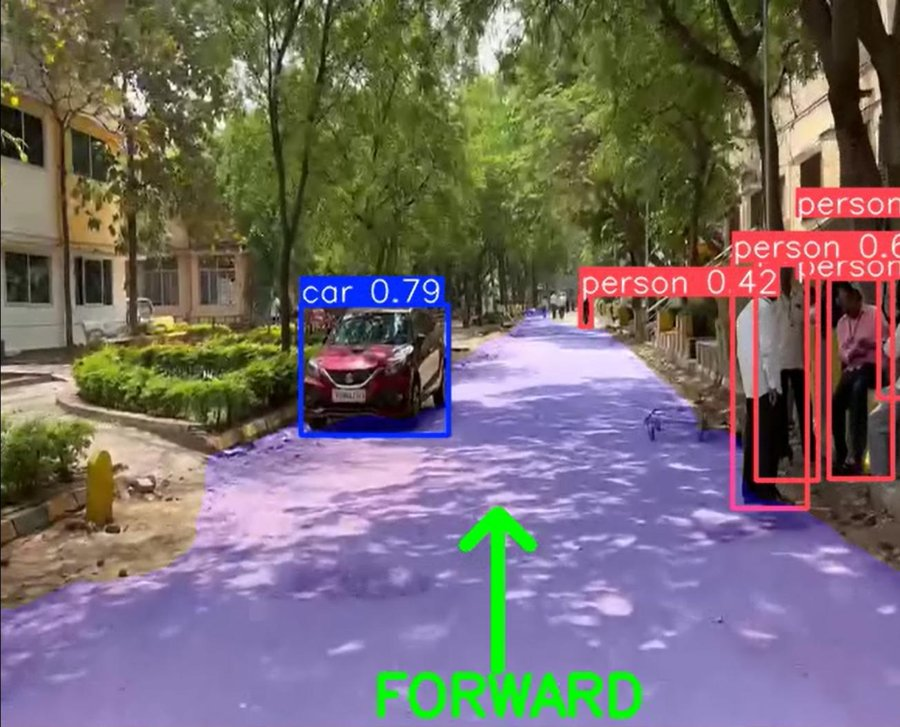

# Navigation for Autonomous Vehicle

A computer-vision project that runs two YOLOv8 models on a video and shows a navigation command (STOP, LEFT, RIGHT or FORWARD) on screen, with the road area highlighted.

B.E. final-year team project (2 members), MVSR Engineering College, 2025-26.

**Tech:** Python, YOLOv8 (Ultralytics), OpenCV, NumPy



*Example output frame from the project report.*

## How it works

1. **Detection model** (`yolov8n.pt`, fine-tuned for 50 epochs) detects objects in each frame and draws a labelled box for every detection with confidence above 0.5.
2. **Command:** if a detection is labelled `stop`, `left`, `right` or `forward`, that label becomes the command shown on screen. With no such detection the command is FORWARD.
3. **Segmentation model** (`yolov8n-seg.pt`, fine-tuned for 50 epochs) predicts the road area, which is drawn as a blue overlay.

## Files

| File | Purpose |
|---|---|
| `train_detection.py` | train the detection model |
| `test_detection.py` | run it on test images |
| `train_segmentation.py` | train the road-segmentation model |
| `test_segmentation.py` | run it on test images |
| `navigate.py` | run both models on a video and show the command |

## Run it

```
pip install -r requirements.txt
python train_detection.py
python train_segmentation.py
python navigate.py
```

You need your own datasets in YOLO format (`dataset/data.yaml` for detection, `seg_dataset/data.yaml` for segmentation) and a `test_video.mp4`. Datasets, trained weights and videos are not stored in this repository.

## Dataset and testing

From the project report (B.E. final-year project, MVSR Engineering College, 2025-26):

- **Detection:** a custom dataset of annotated traffic-sign images (STOP, LEFT, RIGHT, FORWARD) in YOLO format, labelled with LabelImg.
- **Segmentation:** a road-segmentation dataset of road images with masks.
- **Size:** around 2,000+ training images and 500+ test images/video frames.
- **Testing:** 14 manual test cases (detection, segmentation, decision logic, integration) all passed. **Accuracy:** the training and testing notebook reported an mAP50 of 87%. The notebook is not stored in this repository, and FPS was not measured.

## Limitations

- The command comes only from the detection labels. The segmentation result is shown as an overlay and does not change the command.
- It does not measure distance or judge where an obstacle is relative to the vehicle's path.
- It is a demonstration on recorded video, not a tested driving system.
- The 87% mAP50 comes from the team's notebook output, which is not included here, so it cannot be re-checked from this repository.

## Author

Eithem Shashank
